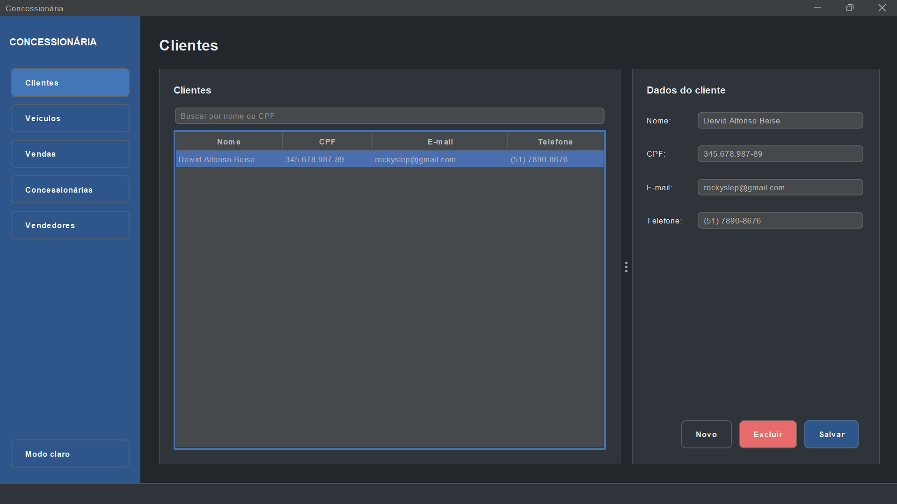
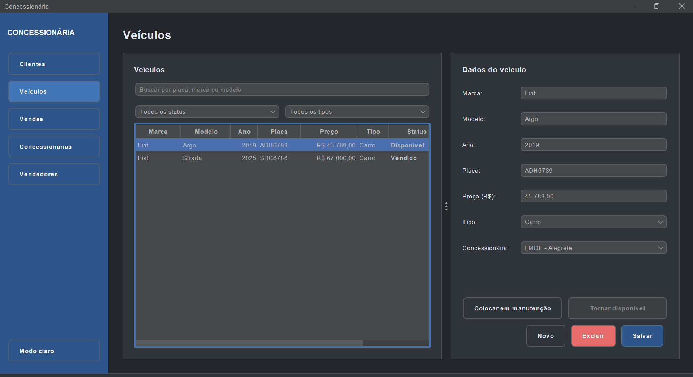
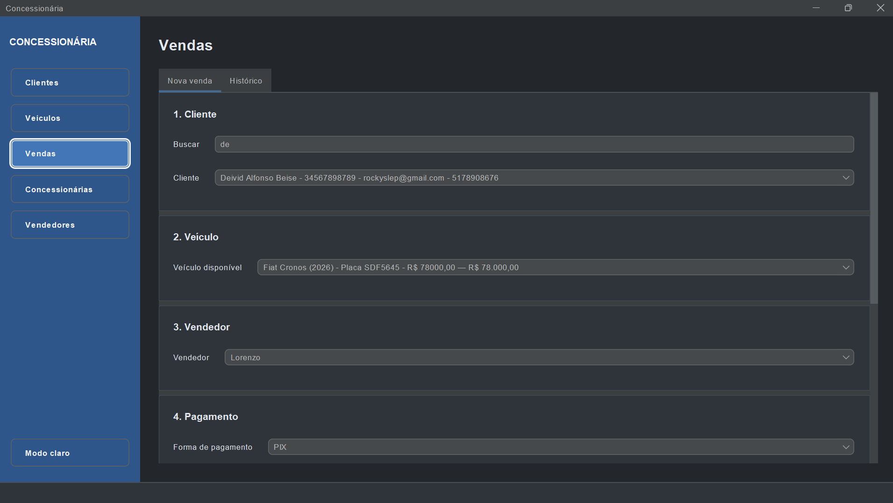
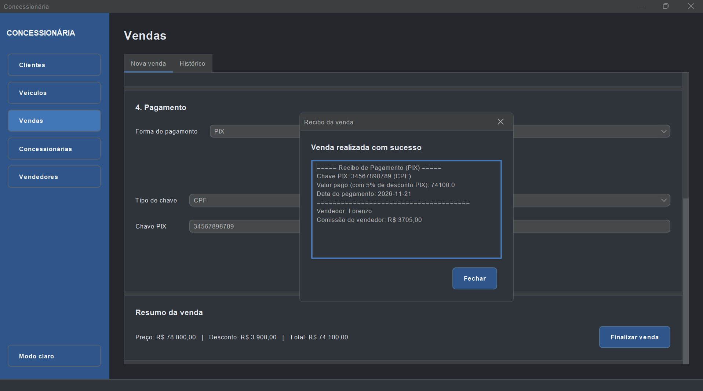
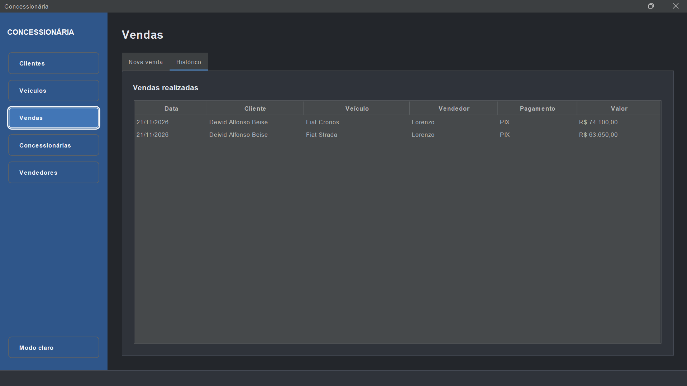
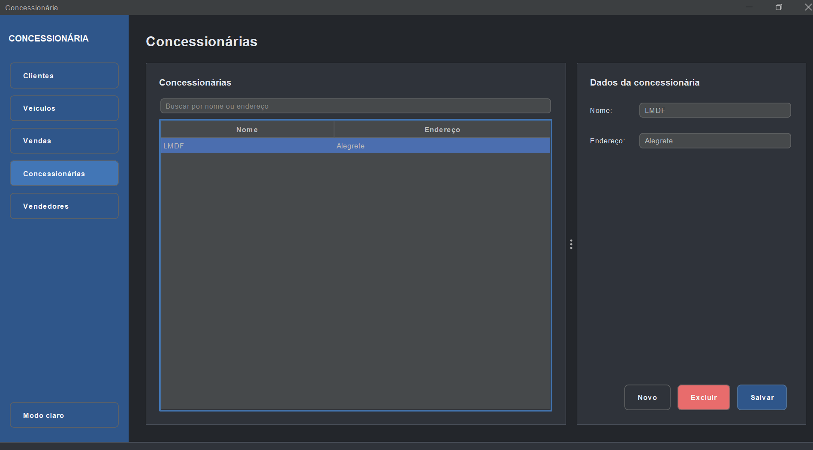
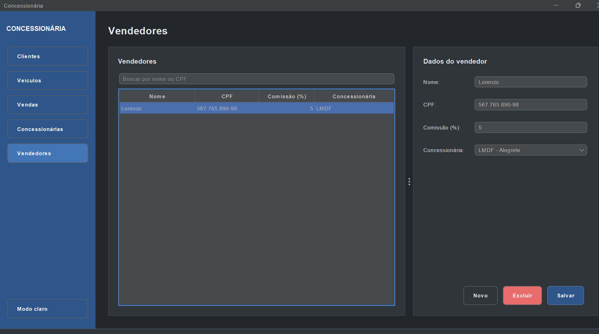
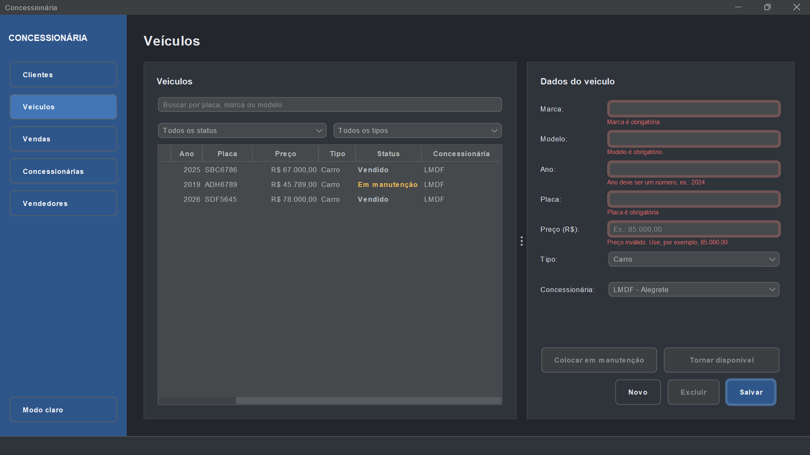

# Concessionária Grupo 2

Sistema de gestão de uma concessionária de veículos, feito em **Java 21 + Swing** com persistência em **MySQL**,
como Trabalho 2 de Programação Orientada a Objetos.

- **Problema:** a concessionária precisa controlar o estoque de carros e motos, manter o cadastro de clientes,
  vendedores e lojas, e registrar vendas com formas de pagamento diferentes, cada uma com suas regras (desconto
  no PIX, parcelamento no cartão, comissão menor para motos).
- **Usuários:** atendentes e vendedores da concessionária.
- **Entidades:** Cliente, Concessionária, Vendedor, Veículo (carro ou moto, com status Disponível /
  Em manutenção / Vendido), Venda e Pagamento (abstrato, com PIX, Cartão e Dinheiro).

### Regras de negócio
- Só é possível vender veículo **disponível**: em manutenção não pode, e vendido não volta a ficar disponível.
- **PIX** tem 5% de desconto. **Cartão** exige número com 16 dígitos, validade MM/AA não vencida, CVV com 3 ou 4
  dígitos e de 1 a 12 parcelas. **Dinheiro** é à vista, sem desconto.
- A comissão do vendedor é o percentual dele sobre o valor da venda; em **motos** o percentual cai 3 pontos.
- A venda só é gravada se passar em todas as regras; venda, pagamento e status do veículo são gravados numa única
  transação (ou tudo, ou nada).
- Cliente, vendedor, veículo ou concessionária que já têm vendas ou vínculos não podem ser excluídos.

## Integrantes

- Deivid Beise
- Matheus Fonseca
- Lorenzo de Brum Schons
- Fernando Nicola

## Como executar

### Pré-requisitos
- **JDK 21 ou superior**
- **Maven 3.9+**
- **MySQL 8** (local ou Docker)

### 1. Banco de dados (criado automaticamente)
Não é preciso rodar SQL à mão: **ao abrir, o app cria ou atualiza as tabelas sozinho** com o
[Flyway](https://documentation.red-gate.com/fd), usando as migrações em
[`src/main/resources/db/migration/`](src/main/resources/db/migration/). Basta ter um MySQL 8 no ar e as
credenciais configuradas (passo 2).

- **Banco vazio:** o app aplica todas as migrações (V1 cria as tabelas, V2 normaliza as placas).
- **Banco que já tinha as tabelas antes do Flyway** (ex.: o do Aiven): a V1 é marcada como já aplicada
  (*baseline*) e só as seguintes rodam.
- **Banco em dia:** nada acontece.
- O histórico fica na tabela `flyway_schema_history`. Se uma migração falhar, o app mostra "Erro ao iniciar"
  com o motivo.
- No MySQL local, o `?createDatabaseIfNotExist=true` na `DB_URL` faz o próprio driver criar o banco
  `projeto_poo` vazio se ele não existir.

Com Docker, se não tiver MySQL instalado:

```bash
docker run -d --name mysql-poo -e MYSQL_ROOT_PASSWORD=senha -p 3306:3306 mysql:8.4
```

**Dados de exemplo (opcional):** [`db/dados.sql`](db/dados.sql) coloca 2 concessionárias, 3 vendedores,
6 veículos (2 motos, 1 em manutenção, 1 vendido), 4 clientes e 1 venda paga com PIX. Rode-o **depois de abrir
o app uma vez** (para as tabelas existirem) e só num banco vazio, nunca no do Aiven:

```bash
mysql -u root -p projeto_poo < db/dados.sql
# ou, com Docker:
docker exec -i mysql-poo mysql -uroot -psenha projeto_poo < db/dados.sql
```

**Criar uma migração nova** (ex.: nova coluna ou tabela):
1. Crie em `src/main/resources/db/migration/` um arquivo com o próximo número:
   `V3__descricao_curta.sql` (V maiúsculo, **dois** sublinhados, descrição com `_`).
2. Escreva só o SQL da mudança (sem `CREATE DATABASE`/`USE`); o Flyway roda dentro do banco da `DB_URL`.
3. Abra o app: a migração é aplicada em todos os bancos (grupo, Aiven, professor) na próxima vez que cada um
   abrir o sistema.
4. **Nunca edite nem renomeie uma migração já aplicada**: o Flyway confere o checksum e para com erro.
   Para corrigir algo, crie outra migração (V4, V5...).

### 2. Configurar as credenciais
O sistema lê a conexão de três variáveis de ambiente: `DB_URL`, `DB_USER` e `DB_PASSWORD`.
Nenhuma senha fica no código.

**PowerShell** (vale para o terminal aberto):

```powershell
$env:DB_URL = "jdbc:mysql://localhost:3306/projeto_poo?createDatabaseIfNotExist=true"
$env:DB_USER = "root"
$env:DB_PASSWORD = "senha"
```

**Arquivo `.env`** (copie o [`.env.example`](.env.example); o `.env` não é versionado):

```env
DB_URL=jdbc:mysql://localhost:3306/projeto_poo?createDatabaseIfNotExist=true
DB_USER=root
DB_PASSWORD=senha
```

O Java não lê o `.env` sozinho: carregue-o no terminal antes de executar (por exemplo, no Git Bash
`set -a; source .env; set +a`) ou configure as variáveis na execução da IDE.

### 3. Executar

```bash
mvn compile exec:java "-Dexec.mainClass=apresentacao.TelaPrincipal"
```

Se as variáveis não estiverem definidas, o sistema abre uma mensagem dizendo quais faltam.

## Arquitetura

```
                 ┌──────────────────────────────┐
                 │ config (AppConfig)           │  monta tudo: cria DAOs, políticas e services
                 └──────────────┬───────────────┘
                                │ injeta
          ┌─────────────────────┼─────────────────────────┐
          ▼                     ▼                         ▼
┌──────────────────┐   ┌──────────────────┐      ┌──────────────────┐
│ apresentacao     │──▶│ aplicacao        │─────▶│ dominio          │◀──── infra
│ telas Swing      │   │ casos de uso,    │      │ entidades,       │      DAOs JDBC,
│                  │   │ DTOs, pagamento  │      │ regras, portas   │      conexão,
└──────────────────┘   └──────────────────┘      └──────────────────┘      transação
```

As setas apontam a direção das dependências: `apresentacao → aplicacao → dominio ← infra`.
O domínio não conhece ninguém; a infra implementa as interfaces do domínio; só o `config` conhece as classes
concretas.

| Pacote | O que contém |
|--------|--------------|
| `dominio.modelo` | Entidades e suas regras: `Cliente`, `Veiculo` (abstrato, com `Carro` e `Moto`), `RegistroTiposVeiculo` e `CriadorVeiculo` (criação de veículos pelo tipo), `Venda`, `Vendedor`, `Concessionaria`, `Pagamento` e subclasses, `StatusVeiculo`, `ResumoVenda`, e `Formatacao` (moeda e data no padrão brasileiro). |
| `dominio.politica` | Regras substituíveis: `PoliticaDesconto` (`DescontoPix`, `SemDesconto`) e `PoliticaComissao` (`ComissaoCarro`, `ComissaoMoto`). |
| `dominio.excecao` | Exceções de negócio: `VeiculoIndisponivelException`, `VendaInvalidaException`. |
| `dominio.repositorio` | Portas de persistência (interfaces): um repositório por entidade, mais `DetalhePagamentoRepository`. |
| `aplicacao.servico` | Casos de uso: `ClienteService`, `VeiculoService`, `VendaService`, `VendedorService`, `ConcessionariaService`. |
| `aplicacao.dto` | Dados de entrada sem entidades: `DadosVenda`, `DadosPagamento` (interface comum) e `DadosPix`, `DadosCartao`, `DadosDinheiro`. |
| `aplicacao.pagamento` | `FormaPagamento` e suas implementações (PIX, cartão, dinheiro). |
| `aplicacao` | `Transacao`: porta para executar várias gravações juntas. |
| `infra.conexao` | `ConexaoBanco` (lê as variáveis de ambiente), `ConnectionFactory`, `TransacaoJdbc`, `MigradorBanco` (aplica as migrações do Flyway). |
| `infra.dao` | DAOs JDBC que implementam os repositórios, mais `ExecutorSql` e `ErrosSql`. |
| `infra.excecao` | `PersistenciaException`: erro de banco não verificado. |
| `apresentacao` | Telas (`ClienteFront`, `VeiculoFront`, `VendaFront`, `ConcessionariaFront`, `VendedorFront`, `TelaPrincipal`), os `TableModel`s e o `VeiculoCelulaRenderer` (preço e status coloridos na tabela de veículos). |
| `apresentacao.comum` | Comportamento compartilhado das telas: `TarefaEmSegundoPlano`, `Feedback`, `Validacao`, `BarraStatus`, `TelaComDados`, `TelaComBotaoPrincipal`. |
| `apresentacao.estilo` | Visual único: `Tema` (cores, fontes, espaçamentos) e `Componentes` (fábrica de botões, campos, cartões). |
| `config` | `AppConfig`: o único lugar que cria DAOs e liga as dependências. |

## Onde cada requisito foi atendido

### SOLID
- **SRP (responsabilidade única):** cada camada tem um motivo para mudar. As regras ficam nas entidades
  (`Veiculo.vender`, `Venda.finalizarVenda`), o fluxo nos services, o SQL nos DAOs e o desenho nas telas.
  Até a tela foi dividida: `ClienteFront` desenha, `ClienteTableModel` formata a tabela, `Validacao` marca
  erros e `Feedback` mostra mensagens.
- **OCP (aberto/fechado):**
  - **Pagamento em dinheiro sem mexer no `VendaService`.** Para criar a forma nova bastaram
    [`DadosDinheiro`](src/main/java/aplicacao/dto/DadosDinheiro.java),
    [`PagamentoDinheiro`](src/main/java/dominio/modelo/PagamentoDinheiro.java),
    [`FormaPagamentoDinheiro`](src/main/java/aplicacao/pagamento/FormaPagamentoDinheiro.java) e uma linha no
    [`AppConfig`](src/main/java/config/AppConfig.java). O `VendaService` escolhe a forma pelo tipo do DTO, num
    mapa recebido pronto. Prova: o commit que adicionou o dinheiro não altera o `VendaService`, e o comando abaixo
    sai vazio.
    ```bash
    git show --stat b4aec43   # lista só DTO, modelo, forma de pagamento, AppConfig e VendaFront
    git diff aadc459 b4aec43 -- src/main/java/aplicacao/servico/VendaService.java   # saída vazia
    ```
  - **Tipos de veículo por herança.** [`Veiculo`](src/main/java/dominio/modelo/Veiculo.java) é abstrato:
    [`Carro`](src/main/java/dominio/modelo/Carro.java) e [`Moto`](src/main/java/dominio/modelo/Moto.java)
    dizem o próprio tipo (`getTipo()`) e escolhem a própria política de comissão (`politicaComissao()`,
    devolvendo [`ComissaoCarro`](src/main/java/dominio/politica/ComissaoCarro.java) ou
    [`ComissaoMoto`](src/main/java/dominio/politica/ComissaoMoto.java)). A `Venda` só chama
    `veiculo.politicaComissao()`, e `VeiculoService`, `VeiculoDAO` e `VeiculoFront` criam e listam veículos pelo
    [`RegistroTiposVeiculo`](src/main/java/dominio/modelo/RegistroTiposVeiculo.java), montado no `AppConfig`.
    Um `Caminhao` novo seria só `Caminhao extends Veiculo` + `ComissaoCaminhao` + uma linha no
    [`AppConfig`](src/main/java/config/AppConfig.java) (`.registrar("CAMINHAO", Caminhao::new)`): nada muda na
    `Venda`, no serviço, no DAO, na tela nem no banco (a coluna `tipo` já aceita qualquer nome).
  - **`PoliticaDesconto`** ([`DescontoPix`](src/main/java/dominio/politica/DescontoPix.java),
    [`SemDesconto`](src/main/java/dominio/politica/SemDesconto.java)): uma promoção nova é só outra classe,
    entregue pelo `AppConfig` à forma de pagamento.
- **LSP (substituição de Liskov):** [`Pagamento`](src/main/java/dominio/modelo/Pagamento.java) é abstrato, e
  `PagamentoPix`, `PagamentoCartao` e `PagamentoDinheiro` podem ser usados em qualquer lugar que espera um
  `Pagamento`. A `Venda` calcula valor, comissão e recibo (`obterReciboDetalhado`) sem saber qual é a subclasse.
- **ISP (segregação de interfaces):** repositórios pequenos e específicos em
  [`dominio/repositorio`](src/main/java/dominio/repositorio/). `PagamentoRepository` só grava a parte comum,
  `DetalhePagamentoRepository<T>` só o detalhe de cada forma, e `VendaRepository` não tem métodos de cliente nem
  de veículo.
- **DIP (inversão de dependência):** os services recebem interfaces (`ClienteRepository`, `Transacao`,
  `FormaPagamento`...) pelo construtor e não conhecem JDBC. As classes concretas só se encontram no
  [`AppConfig`](src/main/java/config/AppConfig.java), que também injeta as políticas de desconto.

### Clean Architecture
- **Regra de dependência:** `dominio` e `aplicacao` não importam `apresentacao`, `infra`, `config`, `java.sql`,
  `java.awt` nem `javax.swing`. Dá para conferir com:
  `grep -rnE "import (apresentacao|infra|config|java\.sql|java\.awt|javax\.swing)" src/main/java/dominio src/main/java/aplicacao`
  (saída vazia).
- **DTOs na fronteira:** a tela envia só valores simples (`DadosVenda` com IDs e `DadosPix`/`DadosCartao`/
  `DadosDinheiro`) e recebe `ResumoVenda` no histórico. As conversões do formato do banco (ex.: `'Pix'` →
  `"PIX"`) ficam nos DAOs.
- **Casos de uso sem a tela:** os services funcionam sem Swing. Por exemplo,
  `new AppConfig().vendaService().vender(new DadosVenda(2L, 2L, 5L, new DadosDinheiro()))` realiza uma venda
  completa a partir de qualquer `main` ou teste.

### Clean Code
- **Nomes do domínio** em português e verbos claros (`finalizarVenda`, `colocarEmManutencao`, `listarDisponiveis`).
- **Sem duplicação no JDBC:** [`ExecutorSql`](src/main/java/infra/dao/ExecutorSql.java) concentra abrir conexão,
  `PreparedStatement`, ID gerado e tradução de erro; [`ErrosSql`](src/main/java/infra/dao/ErrosSql.java)
  reconhece chave estrangeira e valor duplicado, e os DAOs transformam isso em mensagens de negócio.
- **Erros explícitos:** [`PersistenciaException`](src/main/java/infra/excecao/PersistenciaException.java) (não
  verificada) para falhas de banco; `IllegalArgumentException` para dado inválido; `IllegalStateException` para
  "possui vendas" ou "não encontrado"; exceções de domínio para venda inválida e veículo indisponível.
- **Regras em um lugar só:** as telas validam chamando as mesmas regras do domínio (`Cliente.validarCpf`,
  `PagamentoCartao.validarValidade`...), sem copiar a lógica.
- **Formatação em um lugar só:** [`Formatacao`](src/main/java/dominio/modelo/Formatacao.java) é o único ponto
  que formata moeda (`R$ 74.100,00`) e data (`21/11/2026`). Recibos, tela de vendas e tabela de veículos usam
  essa classe em vez de cada um ter o seu `String.format`/`DecimalFormat`.

### Interface gráfica
- **Visual único:** [`Tema`](src/main/java/apresentacao/estilo/Tema.java) tem todas as cores, fontes e
  espaçamentos; [`Componentes`](src/main/java/apresentacao/estilo/Componentes.java) cria botões, campos,
  cartões e formulários alinhados. O tema base é o **FlatLaf**, com **modo claro e escuro**
  (`FlatLightLaf`/`FlatDarkLaf`): o botão no rodapé do menu (Alt+R) alterna entre eles e a escolha fica salva
  com `Preferences`.
- **Layout que se adapta:** lista e formulário ficam num `JSplitPane`; o formulário nunca é cortado e, se as
  colunas não couberem, a tabela ganha rolagem horizontal em vez de esconder dados.
- **Janela não trava:** todo acesso a banco passa por
  [`TarefaEmSegundoPlano`](src/main/java/apresentacao/comum/TarefaEmSegundoPlano.java) (SwingWorker), que
  desabilita o botão durante a operação.
- **Feedback consistente:** [`Feedback`](src/main/java/apresentacao/comum/Feedback.java) mostra sucesso, erro
  e confirmação; [`Validacao`](src/main/java/apresentacao/comum/Validacao.java) marca o campo inválido com
  contorno vermelho e a mensagem embaixo dele.
- **Teclado:** Alt+C/V/E/O/D no menu e Alt+R para o modo escuro; Alt+N/S/X (Novo, Salvar, Excluir) nos
  cadastros, mais Alt+M/T (manutenção, tornar disponível) em Veículos; em Vendas, Alt+N/H trocam entre
  "Nova venda" e "Histórico" e Alt+F finaliza; Enter aciona o botão principal de cada tela
  (`TelaComBotaoPrincipal`); foco visível com anel de 2 px; rótulos ligados aos campos (`setLabelFor`) e nomes
  acessíveis nas buscas e tabelas.
- Conferência manual tela por tela: [`docs/checklist-telas.md`](docs/checklist-telas.md).

### Banco de dados
- **Repositórios:** interfaces em `dominio.repositorio`, implementadas pelos DAOs de `infra.dao`.
- **Segurança:** todo SQL usa `PreparedStatement` com parâmetros, sem concatenar valores digitados.
- **Transação:** [`TransacaoJdbc`](src/main/java/infra/conexao/TransacaoJdbc.java) faz a venda gravar venda,
  pagamento, detalhe do pagamento e status do veículo juntos, com rollback se algo falhar.
- **Mecanismo automático de criação do banco:** [Flyway](https://documentation.red-gate.com/fd). Ao iniciar,
  [`MigradorBanco`](src/main/java/infra/conexao/MigradorBanco.java) aplica as migrações versionadas de
  [`db/migration`](src/main/resources/db/migration/), criando as tabelas num banco vazio ou atualizando um banco
  existente; todos os bancos (grupo, Aiven, professor) ficam na mesma versão sem rodar SQL à mão.
  [`db/dados.sql`](db/dados.sql) é opcional, só para dados de exemplo.

### JavaDoc
- Toda classe, interface, record, enum, construtor e método público está documentado.
- O HTML gerado está em [`docs/javadoc/index.html`](docs/javadoc/index.html) (abra no navegador).
- Para gerar de novo: `mvn javadoc:javadoc` (configurado no `pom.xml` com o `maven-javadoc-plugin`).

## Capturas de tela

| | |
|---|---|
|  |  |
| Clientes | Veículos |
|  |  |
| Nova venda | Recibo |
|  |  |
| Histórico de vendas | Concessionárias |
|  |  |
| Vendedores | Erro de validação embaixo do campo |

## Checklist do Trabalho 1

| Conceito | Como este projeto cumpre o item |
|---|---|
| Classes e objetos Java | Classes de domínio como `Cliente`, `Veiculo` e `Venda` são instanciadas e manipuladas ao longo do fluxo de cadastro e venda. |
| Atributos de classe Java | `Veiculo` armazena `marca`, `modelo`, `ano`, `placa`, `preco` e `status`, entre outros, como estado do objeto. |
| Métodos de classe Java | `Veiculo.vender()`, `Venda.finalizarVenda()` e `Pagamento.obterReciboDetalhado()` são comportamentos das classes corretas. |
| Construtores em Java | O construtor de `Veiculo` exige marca, modelo, ano, placa (formato `ABC1234` ou `ABC1D23`) e preço válidos, lançando `IllegalArgumentException` se algo estiver incorreto. |
| Palavra-chave `this` | Usada nos construtores de `Cliente`, `Veiculo`, `Vendedor` e `Concessionaria` para diferenciar atributo de parâmetro (ex.: `this.ano = ano`, `this.nome = validarNome(nome)`). |
| Modificadores Java | Atributos `private`/`private final`; não existe `setStatus` público em `Veiculo`. |
| Encapsulamento em Java | O status do veículo só muda por `vender()`, `colocarEmManutencao()` e `tornarDisponivel()`, que impõem as transições válidas. |
| Pacotes Java / API | Código em camadas (`dominio`, `aplicacao`, `infra`, `apresentacao`, `config`); domínio e aplicação não dependem do banco nem da tela. |
| Herança em Java | `PagamentoPix`, `PagamentoCartao` e `PagamentoDinheiro` estendem a classe abstrata `Pagamento`; `Carro` e `Moto` estendem a classe abstrata `Veiculo`. |
| Polimorfismo em Java | A `Venda` usa qualquer pagamento pelo tipo `Pagamento` e chama `obterReciboDetalhado()` sem saber a subclasse; do mesmo jeito, chama `veiculo.politicaComissao()` sem saber se o `Veiculo` é `Carro` ou `Moto`. |
| Palavra-chave `super` | Os construtores das subclasses chamam `super(venda, "PIX", valorBase, dataPagamento, politicaDesconto)` (idem com `"Cartão"` e `"Dinheiro"`). |
| Abstração em Java | `Pagamento` é abstrata e declara o método abstrato `obterReciboDetalhado()`; `Veiculo` é abstrata e declara `politicaComissao()` e `getTipo()`, implementados por `Carro` e `Moto`. |
| Interfaces em Java | `PoliticaDesconto` (`DescontoPix`, `SemDesconto`) e `PoliticaComissao` (`ComissaoCarro`, `ComissaoMoto`). |
| Enum em Java | `StatusVeiculo { DISPONIVEL, VENDIDO, EM_MANUTENCAO }` evita estados inválidos. |
| Tratamento de exceções em Java | `VeiculoIndisponivelException` e `VendaInvalidaException` são lançadas nas regras de negócio e tratadas nas telas pelo `Feedback`. |
| Interface gráfica com Swing | `TelaPrincipal` com menu lateral reúne `ClienteFront`, `VeiculoFront`, `VendaFront`, `ConcessionariaFront` e `VendedorFront`. |
| Data e hora em Java | `LocalDate` nas datas de venda e pagamento; `YearMonth` valida a validade do cartão. |
